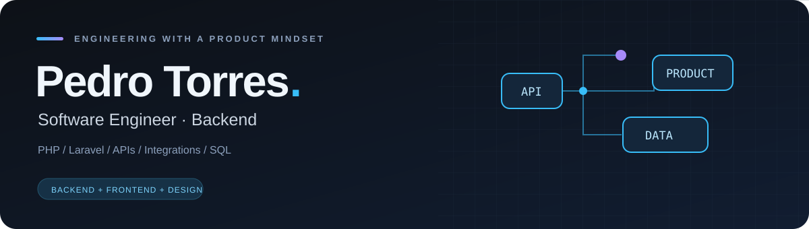

  

<strong>Backend com visão de produto e atenção ao design.</strong> PHP · Laravel · APIs · Integrações · Bancos de dados

  
  

---

### 👨🏻‍💻 Sobre mim

Sou **Pedro Torres**, desenvolvedor de software com foco em **backend** e estudante de **Engenharia de Software**, em São Paulo, Brasil. Trabalho principalmente com **PHP, Laravel e MySQL/MariaDB**, transformando necessidades e regras de negócio em sistemas, APIs, integrações e automações.

Também desenvolvo interfaces e landing pages com **Next.js, TypeScript, JavaScript, HTML e CSS**. Meu conhecimento em **design** complementa a engenharia: procuro conectar uma implementação bem estruturada a uma experiência clara, consistente e visualmente bem resolvida.

<table>
<tr>
<td width="50%" valign="top">

#### ⚙️ Backend & dados

APIs REST, autenticação, validação, regras de negócio, processamento com Jobs e integrações entre sistemas. Modelagem relacional, consultas SQL, relacionamentos e índices.

</td>
<td width="50%" valign="top">

#### 🎨 Frontend & design

Interfaces responsivas, hierarquia visual e atenção aos detalhes. Experiência com aplicações web e landing pages, conectando o funcionamento do sistema à apresentação do produto.

</td>
</tr>
</table>

### 🛠️ Tecnologias

**Backend e bancos de dados**

  &nbsp;
  &nbsp;
  

**Frontend**

  &nbsp;
  &nbsp;
  &nbsp;
  &nbsp;
  

**Versionamento**

### 🧭 Como trabalho

- **Entender o problema:** traduzir necessidades, fluxos e regras de negócio em uma solução técnica.
- **Estruturar a implementação:** organizar endpoints, dados, relacionamentos e responsabilidades do código.
- **Construir e revisar:** desenvolver, investigar falhas e validar o comportamento da solução.
- **Cuidar da entrega:** considerar documentação, manutenção e experiência de quem usa o produto.

Minha experiência também inclui **Salesforce CRM e Marketing Cloud**, especialmente em integrações e automações de processos. Hoje, meu foco profissional está em **engenharia de software e backend**.

### 📊 GitHub

  
  

---

<strong>Vamos construir algo bem pensado.</strong> <a href="https://www.linkedin.com/in/pedrotorres-dev/">Entre em contato pelo LinkedIn ↗</a>

